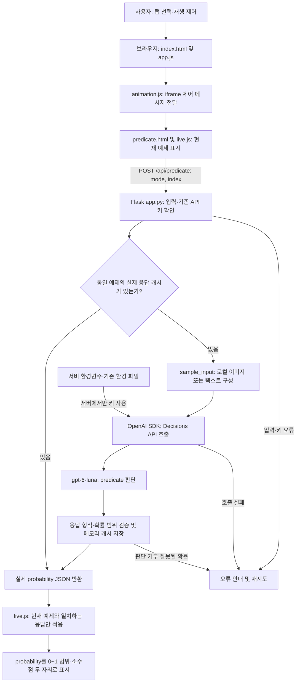

두번째 블로그에서는 공식 [Decisions 가이드의 Check an image for visible damage](https://developers.openai.com/api/docs/guides/decisions#check-an-image-for-visible-damage) 내용을 그대로 로컬 PC 또는 Mac 환경에서 실행하는 프로젝트이다. 이 프로젝트는 이미지에서 눈에 보이는 손상 여부를 확인하는 Predicate API 프로젝트로 여러분이 모두 실행하고 나면 다음과 같은 화면을 보게 될 것이다.

{: style="width: 70%; height: auto;"}

- Dent / Cancellation / Answer relevance 탭
- 공식 제품 이미지와 텍스트 샘플 애니메이션
- Pause animation / Resume animation
- 0~1 probability 표시
- 키보드 좌우 화살표와 Home/End 탭 전환

---

# 1. 실제 API 연결

실제 Decisions API를 연결하려면 `OPENAI_API_KEY`가 필요하다. 서버 환경 변수인 `.env`의 `OPENAI_API_KEY`를 작성한다.

현재 표시되는 항목만 `/api/predicate`로 요청한다. 응답을 기다리는 동안에는 `—`를 표시하고 실제 응답의 probability를 0~1 범위, 소수점 두 자리로 표시한다. 실패·거부 시 샘플 값으로 대체하지 않고 오류 및 재시도 버튼을 표시한다. 탭을 전환해도 이전 요청의 결과가 다른 항목에 섞이지 않는다.

새 항목 판단에는 API 사용량이 발생한다. 자동 재생 시 이미지 5개와 텍스트 각 3개를 순환한다. 동일 항목의 실제 응답은 서버 실행 중 메모리에 보관해 재사용하며 서버 재시작 시 초기화된다. Pause animation으로 자동 전환을 중지할 수 있다.

---

# 2. 예제 실행

## 2-1. Windows 11 운영체제 (PowerShell)

```powershell
python -m venv .venv
.\.venv\Scripts\Activate.ps1
.\.venv\Scripts\python.exe -m pip install -r requirements.txt
.\.venv\Scripts\python.exe app.py
```

Windows 11 환경에서 같은 PC의 Edge 또는 Chrome에서 [http://127.0.0.1:5052/](http://127.0.0.1:5052/)에 접속한다. 서버 창은 열어 둔다. Windows 파일 탐색기에서 `run-local.cmd`를 더블클릭해도 실행할 수 있다. 다른 포트는 `python app.py --port 5053`처럼 지정한다.

## 2-2. macOS / Linux 운영체제 (bash·zsh)

Python 3.10 이상이 설치된 환경에서 `decisions-visible-damage` 프로젝트 폴더로 이동한 뒤 다음 명령을 실행한다. 기존 API 키는 위의 실제 API 연결 설명에 따라 `.env`에 설정한다.

```bash
python3 -m venv .venv
source .venv/bin/activate
./.venv/bin/python -m pip install -r requirements.txt
./.venv/bin/python app.py
```

같은 컴퓨터의 브라우저에서 [http://127.0.0.1:5052/](http://127.0.0.1:5052/)에 접속한다. 실행 중인 터미널은 열어 둔다. 다른 포트를 사용하려면 `./.venv/bin/python app.py --port 5053`으로 실행하고 [http://127.0.0.1:5053/](http://127.0.0.1:5053/)에 접속한다. `run-local.cmd`는 Windows 전용이다.

서버는 `Ctrl+C`로 종료하고, 가상환경은 `deactivate`로 비활성화한다.

참고로 Codex의 제한된 실행 환경이나 내부 미리보기에서 연결 시간이 초과되면 일반 Windows Terminal 또는 PowerShell에서 실행하고 일반 브라우저로 접속한다.

---

# 3. 아키텍처 플로우



응답 대기 중에는 `—`를 표시한다. 캐시는 서버 메모리에만 유지하며 서버 재시작 시 초기화한다. 새 판단에는 API 사용량이 발생하고, 캐시된 실제 응답을 반환할 때는 API를 다시 호출하지 않는다. API 키는 브라우저에 전달하지 않는다.

---

# 4. 전체 폴더별 파일 구성

| 폴더                  | 파일명                              | 내용 및 역할                                                                                   |
| --------------------- | ----------------------------------- | ---------------------------------------------------------------------------------------------- |
| 프로젝트 루트         | `.env.example`                    | 키 값 없이 환경변수 설정 방법을 제공하는 예제 파일이다.                                        |
| 프로젝트 루트         | `.gitignore`                      | 환경 파일, 가상환경, Python 캐시 등 Git에서 제외할 항목을 지정한다.                            |
| 프로젝트 루트         | `app.py`                          | Flask 화면 제공, 예제 입력 검증, 실제 Decisions API 호출, 확률 검증 및 메모리 캐시를 처리한다. |
| 프로젝트 루트         | `README.md`                       | 프로젝트 설명, 실행 방법, API 동작, 아키텍처와 파일 구성을 안내한다.                           |
| 프로젝트 루트         | `requirements.txt`                | Flask, OpenAI SDK, python-dotenv 등 실행 의존성을 정의한다.                                    |
| 프로젝트 루트         | `run-local.cmd`                   | Windows에서 프로젝트 가상환경의 Python으로 서버를 실행한다.                                    |
| `scripts/`          | `verify_ui.py`                    | Edge와 Playwright로 탭, 확률 표시, 재생 제어 및 모바일 화면을 검증한다.                        |
| `static/`           | `animation.js`                    | 상위 화면과 iframe 사이에 탭·재생·높이·API 상태 및 재시도 메시지를 전달한다.                |
| `static/`           | `app.js`                          | 상위 화면의 탭 선택과 방향키·Home·End 접근성 동작을 처리한다.                                |
| `static/reference/` | `bottle.webp`                     | 손상되지 않은 노란색 금속 병 이미지 예제다.                                                    |
| `static/reference/` | `can.webp`                        | 찌그러진 알루미늄 캔 이미지 예제다.                                                            |
| `static/reference/` | `demo.css`                        | 공식 데모의 이미지·문구·확률 표시 영역과 반응형 스타일을 정의한다.                           |
| `static/reference/` | `demo.js`                         | 기존 스크립트가 live.js로 대체되었음을 알리는 안내 주석만 담는다.                              |
| `static/reference/` | `dented-mug.webp`                 | 눈에 띄게 찌그러진 파란색 머그 이미지 예제다.                                                  |
| `static/reference/` | `dimpled-tin.webp`                | 작고 얕은 눌림이 있는 금속 용기 이미지 예제다.                                                 |
| `static/reference/` | `live.js`                         | 현재 예제의 API 요청, 대기·결과 표시, 자동 전환과 재생 제어를 처리한다.                       |
| `static/reference/` | `OpenAISans-Bold.woff2`           | OpenAI Sans의 굵은 글꼴을 WOFF2 형식으로 제공한다.                                             |
| `static/reference/` | `OpenAISans-BoldItalic.woff2`     | OpenAI Sans의 굵은 기울임 글꼴을 WOFF2 형식으로 제공한다.                                      |
| `static/reference/` | `OpenAISans-Medium.woff`          | OpenAI Sans의 중간 굵기 글꼴을 WOFF 형식으로 제공한다.                                         |
| `static/reference/` | `OpenAISans-Medium.woff2`         | OpenAI Sans의 중간 굵기 글꼴을 WOFF2 형식으로 제공한다.                                        |
| `static/reference/` | `OpenAISans-MediumItalic.woff2`   | OpenAI Sans의 중간 굵기 기울임 글꼴을 WOFF2 형식으로 제공한다.                                 |
| `static/reference/` | `OpenAISans-Regular.woff`         | OpenAI Sans의 기본 글꼴을 WOFF 형식으로 제공한다.                                              |
| `static/reference/` | `OpenAISans-Regular.woff2`        | OpenAI Sans의 기본 글꼴을 WOFF2 형식으로 제공한다.                                             |
| `static/reference/` | `OpenAISans-RegularItalic.woff2`  | OpenAI Sans의 기본 기울임 글꼴을 WOFF2 형식으로 제공한다.                                      |
| `static/reference/` | `OpenAISans-Semibold.woff2`       | OpenAI Sans의 약간 굵은 글꼴을 WOFF2 형식으로 제공한다.                                        |
| `static/reference/` | `OpenAISans-SemiboldItalic.woff2` | OpenAI Sans의 약간 굵은 기울임 글꼴을 WOFF2 형식으로 제공한다.                                 |
| `static/reference/` | `predicate.html`                  | Dent, Cancellation, Answer relevance의 iframe 내부 화면 구조와 고정 예제를 정의한다.           |
| `static/reference/` | `SOURCE.md`                       | 공식 데모 자료의 출처와 스냅샷 정보를 기록한다.                                                |
| `static/reference/` | `travel-cup.webp`                 | 매끄러운 초록색 여행용 컵 이미지 예제다.                                                       |
| `static/`           | `style.css`                       | 상위 데모 페이지의 글꼴, 여백, 탭 및 반응형 스타일을 정의한다.                                 |
| `templates/`        | `index.html`                      | Flask가 렌더링하는 메인 화면으로 상위 탭, 재생 버튼, iframe 및 상태 안내를 배치한다.           |
| `tests/`            | `test_app.py`                     | API 입력·요청·캐시·판단 거부 처리와 화면·정적 파일을 모의 응답으로 검증한다.               |

---

# 5. 메인 소스 - app.py 설명

```python
import base64
import math
import os
import threading
import argparse

from pathlib import Path

from dotenv import load_dotenv
from flask import Flask, render_template, request, jsonify
from openai import OpenAI, OpenAIError

ROOT = Path(__file__).resolve().parent

# 기존 설정을 우선하면서 로컬 키 파일을 순서대로 읽는다.
for env in (ROOT / '.env.local', ROOT / '.env'):
    load_dotenv(env)
if os.environ.get('OPENAI_ENV_FILE'):
    load_dotenv(os.environ['OPENAI_ENV_FILE'])

# 현재 환경에 키가 없을 때만 기존 형제 프로젝트의 키 파일을 읽는다.
elif not os.environ.get('OPENAI_API_KEY'):
    load_dotenv(ROOT.parent / 'decisions-complaint-router-BAK' / '.env')

cache = {}
cache_lock = threading.Lock()


def sample_input(mode, index):
    # 배포된 HTML의 문구를 직접 읽어 화면과 API 입력이 일치하도록 한다.
    # 화면에 표시되는 고정 예제를 이미지 또는 텍스트 증거와 판단 질문으로 구성한다.
    from html.parser import HTMLParser

    # HTML에서 현재 예제의 인용문을 추출하는 상태를 관리한다.
    class Quotes(HTMLParser):
        def __init__(self):
            # HTML에서 추출할 문구 목록과 현재 수집 상태를 초기화한다.
            super().__init__()
            self.values = []
            self.active = False
        def handle_starttag(self, tag, attrs):
            # 대상 인용문 태그를 만나면 새로운 문구 수집을 시작한다.
            if tag == 'blockquote' and dict(attrs).get('class', '').split()[0] == ('cancel-quote' if mode == 'cancellation' else 'relevance-quote'):
                self.active = True
                self.values.append('')
        def handle_data(self, data):
            # 대상 태그 안의 텍스트를 현재 문구에 추가한다.
            if self.active:
                self.values[-1] += data
        def handle_endtag(self, tag):
            # 인용문 태그가 닫히면 현재 문구 수집을 종료한다.
            if tag == 'blockquote':
                self.active = False

    # HTMLParser를 사용해 예제 문구를 추출하고 판단 질문과 함께 반환한다.
    if mode == 'dent':
        names = ['can', 'bottle', 'travel-cup', 'dented-mug', 'dimpled-tin']
        encoded = base64.b64encode((ROOT / 'static/reference' / (names[index] + '.webp')).read_bytes()).decode()
        return [{'role': 'user', 'content': [{'type': 'input_image', 'image_url': 'data:image/webp;base64,' + encoded}]}], 'Does this item have a dent?'

    parser = Quotes()
    parser.feed((ROOT / 'static/reference/predicate.html').read_text(encoding='utf-8'))
    evidence = parser.values[index]

    # 판단 질문을 예제 종류에 따라 반환한다.
    if mode == 'cancellation':
        return evidence, 'Does this customer want to cancel their subscription?'
    return 'Question: Can I return an item after 30 days?\nAnswer: ' + evidence, 'Does the answer directly address the question?'


def evaluate_sample(mode, index):
    # 동일 예제의 중복 호출을 막고 실제 API 확률을 검증해 재사용한다.
    # 동시 요청에서도 같은 예제를 중복 판단하지 않도록 캐시 접근과 호출을 잠근다.
    with cache_lock:
        key = (mode, index)
        if key in cache:
            return {**cache[key], 'cached': True}
        evidence, instructions = sample_input(mode, index)

        # 요청 시간이 무한정 늘어나지 않도록 제한하고 사용이 끝나면 API 클라이언트를 닫는다.
        with OpenAI(timeout=45, max_retries=0) as client:
            # 선택한 입력과 질문을 실제 Decisions API로 전달한다.
            result = client.decisions.create(model='gpt-6-luna', input=evidence,
                questions=[{'type': 'predicate', 'name': mode, 'instructions': instructions}])
        
        # 반환된 첫 판단의 형식과 확률을 확인할 준비를 한다.
        answer = result.answers[0]
        if answer.type != 'predicate':
            raise ValueError('판단이 거부되었습니다. 확률을 표시할 수 없습니다.')
        probability = answer.probability

        # 유한하지 않은 값과 허용 범위를 벗어난 수치는 정상 결과로 표시하지 않는다.
        if not math.isfinite(probability) or not 0 <= probability <= 1:
            raise ValueError('API 응답의 probability가 올바르지 않습니다.')
        cache[key] = {'probability': probability, 'source': 'decisions_api', 'cached': False}
        return cache[key]

app = Flask(__name__)


@app.get("/")
def index():
    # 루트 주소에서 프로젝트의 데모 화면을 제공한다.
    return render_template("index.html")


@app.post('/api/predicate')
def predicate():
    # 예제 종류와 번호를 확인한 뒤 실제 참거짓 판단 확률을 반환한다.
    data = request.get_json(silent=True)
    if not isinstance(data, dict):
        return jsonify(error='판단할 예제를 지정하세요.'), 400
    mode, index = data.get('mode'), data.get('index')
    counts = {'dent': 5, 'cancellation': 3, 'answer_relevance': 3}
    if not isinstance(mode, str) or mode not in counts or type(index) is not int or not 0 <= index < counts[mode]:
        return jsonify(error='지원하지 않는 예제입니다.'), 400
    # 키가 없으면 외부 요청을 보내지 않고 설정 오류를 반환한다.
    if not os.environ.get('OPENAI_API_KEY'):
        return jsonify(error='서버에 기존 OPENAI_API_KEY를 설정한 뒤 다시 실행하세요.'), 503
    try:
        return jsonify(evaluate_sample(mode, index))
    # API 연결 실패는 비밀정보를 제외한 오류 응답으로 변환한다.
    except OpenAIError:
        return jsonify(error='Decisions API 호출에 실패했습니다. 키 권한, 사용 한도 및 네트워크를 확인하세요.'), 502
    except ValueError as error:
        return jsonify(error=str(error)), 502


# 파일을 직접 실행한 경우에만 서버나 콘솔 작업을 시작한다.
if __name__ == "__main__":

    # 명령줄 인자를 처리해 포트 번호를 지정할 수 있도록 한다.
    parser = argparse.ArgumentParser(description="Decisions 공식 데모 로컬 서버")
    parser.add_argument("--port", type=int, default=5052,
                        help="로컬 서버 포트 (기본값: 5052)")
    args = parser.parse_args()
    # 포트 번호가 유효한 범위인지 확인한다.
    if not 1 <= args.port <= 65535:
        parser.error("포트는 1~65535 사이여야 합니다.")
    app.run(host="127.0.0.1", port=args.port, debug=False)
```

---

# 6. 참고 자료

* [OpenAI Developers 문서](https://developers.openai.com/api/docs/guides/decisions?utm_source=chatgpt.com#check-an-image-for-visible-damage)
* [프로젝트 예제 소스](https://github.com/synabreu/openai-decisions-workshop/tree/main/decisions-visible-damage)
