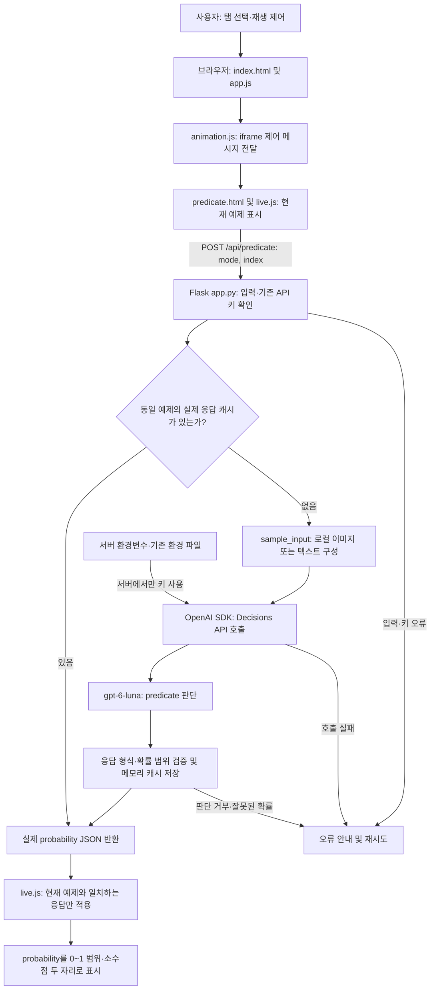

두번째 블로그에서는 공식 [Decisions 가이드의 Check an image for visible damage](https://developers.openai.com/api/docs/guides/decisions#check-an-image-for-visible-damage) 내용을 그대로 로컬 PC 또는 Mac 환경에서 실행하는 프로젝트이다.

이 프로젝트는 이미지에서 눈에 보이는 손상 여부를 확인하는 Predicate API 프로젝트로 여러분이 모두 실행하고 나면 다음과 같은 화면을 보게 될 것이다.

{: style="width: 70%; height: auto;"}

- Dent / Cancellation / Answer relevance 탭
- 공식 제품 이미지와 텍스트 샘플 애니메이션
- Pause animation / Resume animation
- 0~1 probability 표시
- 키보드 좌우 화살표와 Home/End 탭 전환

---

# 1. 실제 API 연결

실제 Decisions API를 연결하려면 `OPENAI_API_KEY`가 필요하다. 서버 환경 변수인 `.env`의 `OPENAI_API_KEY`를 작성한다.

현재 표시되는 항목만 `/api/predicate`로 요청한다. 응답을 기다리는 동안에는 `—`를 표시하고 실제 응답의 probability를 0~1 범위, 소수점 두 자리로 표시한다. 실패·거부 시 샘플 값으로 대체하지 않고 오류 및 재시도 버튼을 표시한다. 탭을 전환해도 이전 요청의 결과가 다른 항목에 섞이지 않는다.

새 항목 판단에는 API 사용량이 발생한다. 자동 재생 시 이미지 5개와 텍스트 각 3개를 순환한다. 동일 항목의 실제 응답은 서버 실행 중 메모리에 보관해 재사용하며 서버 재시작 시 초기화된다. Pause animation으로 자동 전환을 중지할 수 있다.

---

# 2. 예제 실행

## 2-1. Windows 11 운영체제 (PowerShell)

```powershell
python -m venv .venv
.\.venv\Scripts\Activate.ps1
.\.venv\Scripts\python.exe -m pip install -r requirements.txt
.\.venv\Scripts\python.exe app.py
```

Windows 11 환경에서 같은 PC의 Edge 또는 Chrome에서 [http://127.0.0.1:5052/](http://127.0.0.1:5052/)에 접속한다. 서버 창은 열어 둔다. Windows 파일 탐색기에서 `run-local.cmd`를 더블클릭해도 실행할 수 있다. 다른 포트는 `python app.py --port 5053`처럼 지정한다.

## 2-2. macOS / Linux 운영체제 (bash·zsh)

Python 3.10 이상이 설치된 환경에서 `decisions-visible-damage` 프로젝트 폴더로 이동한 뒤 다음 명령을 실행한다. 기존 API 키는 위의 실제 API 연결 설명에 따라 `.env`에 설정한다.

```bash
python3 -m venv .venv
source .venv/bin/activate
./.venv/bin/python -m pip install -r requirements.txt
./.venv/bin/python app.py
```

같은 컴퓨터의 브라우저에서 [http://127.0.0.1:5052/](http://127.0.0.1:5052/)에 접속한다. 실행 중인 터미널은 열어 둔다. 다른 포트를 사용하려면 `./.venv/bin/python app.py --port 5053`으로 실행하고 [http://127.0.0.1:5053/](http://127.0.0.1:5053/)에 접속한다. `run-local.cmd`는 Windows 전용이다.

서버는 `Ctrl+C`로 종료하고, 가상환경은 `deactivate`로 비활성화한다.

참고로 Codex의 제한된 실행 환경이나 내부 미리보기에서 연결 시간이 초과되면 일반 Windows Terminal 또는 PowerShell에서 실행하고 일반 브라우저로 접속한다.

---

# 3. 아키텍처 플로우



응답 대기 중에는 `—`를 표시한다. 캐시는 서버 메모리에만 유지하며 서버 재시작 시 초기화한다. 새 판단에는 API 사용량이 발생하고, 캐시된 실제 응답을 반환할 때는 API를 다시 호출하지 않는다. API 키는 브라우저에 전달하지 않는다.

---

# 4. 전체 폴더별 파일 구성

| 폴더                  | 파일명                              | 내용 및 역할                                                                                   |
| --------------------- | ----------------------------------- | ---------------------------------------------------------------------------------------------- |
| 프로젝트 루트         | `.env.example`                    | 키 값 없이 환경변수 설정 방법을 제공하는 예제 파일이다.                                        |
| 프로젝트 루트         | `.gitignore`                      | 환경 파일, 가상환경, Python 캐시 등 Git에서 제외할 항목을 지정한다.                            |
| 프로젝트 루트         | `app.py`                          | Flask 화면 제공, 예제 입력 검증, 실제 Decisions API 호출, 확률 검증 및 메모리 캐시를 처리한다. |
| 프로젝트 루트         | `README.md`                       | 프로젝트 설명, 실행 방법, API 동작, 아키텍처와 파일 구성을 안내한다.                           |
| 프로젝트 루트         | `requirements.txt`                | Flask, OpenAI SDK, python-dotenv 등 실행 의존성을 정의한다.                                    |
| 프로젝트 루트         | `run-local.cmd`                   | Windows에서 프로젝트 가상환경의 Python으로 서버를 실행한다.                                    |
| `scripts/`          | `verify_ui.py`                    | Edge와 Playwright로 탭, 확률 표시, 재생 제어 및 모바일 화면을 검증한다.                        |
| `static/`           | `animation.js`                    | 상위 화면과 iframe 사이에 탭·재생·높이·API 상태 및 재시도 메시지를 전달한다.                |
| `static/`           | `app.js`                          | 상위 화면의 탭 선택과 방향키·Home·End 접근성 동작을 처리한다.                                |
| `static/reference/` | `bottle.webp`                     | 손상되지 않은 노란색 금속 병 이미지 예제다.                                                    |
| `static/reference/` | `can.webp`                        | 찌그러진 알루미늄 캔 이미지 예제다.                                                            |
| `static/reference/` | `demo.css`                        | 공식 데모의 이미지·문구·확률 표시 영역과 반응형 스타일을 정의한다.                           |
| `static/reference/` | `demo.js`                         | 기존 스크립트가 live.js로 대체되었음을 알리는 안내 주석만 담는다.                              |
| `static/reference/` | `dented-mug.webp`                 | 눈에 띄게 찌그러진 파란색 머그 이미지 예제다.                                                  |
| `static/reference/` | `dimpled-tin.webp`                | 작고 얕은 눌림이 있는 금속 용기 이미지 예제다.                                                 |
| `static/reference/` | `live.js`                         | 현재 예제의 API 요청, 대기·결과 표시, 자동 전환과 재생 제어를 처리한다.                       |
| `static/reference/` | `OpenAISans-Bold.woff2`           | OpenAI Sans의 굵은 글꼴을 WOFF2 형식으로 제공한다.                                             |
| `static/reference/` | `OpenAISans-BoldItalic.woff2`     | OpenAI Sans의 굵은 기울임 글꼴을 WOFF2 형식으로 제공한다.                                      |
| `static/reference/` | `OpenAISans-Medium.woff`          | OpenAI Sans의 중간 굵기 글꼴을 WOFF 형식으로 제공한다.                                         |
| `static/reference/` | `OpenAISans-Medium.woff2`         | OpenAI Sans의 중간 굵기 글꼴을 WOFF2 형식으로 제공한다.                                        |
| `static/reference/` | `OpenAISans-MediumItalic.woff2`   | OpenAI Sans의 중간 굵기 기울임 글꼴을 WOFF2 형식으로 제공한다.                                 |
| `static/reference/` | `OpenAISans-Regular.woff`         | OpenAI Sans의 기본 글꼴을 WOFF 형식으로 제공한다.                                              |
| `static/reference/` | `OpenAISans-Regular.woff2`        | OpenAI Sans의 기본 글꼴을 WOFF2 형식으로 제공한다.                                             |
| `static/reference/` | `OpenAISans-RegularItalic.woff2`  | OpenAI Sans의 기본 기울임 글꼴을 WOFF2 형식으로 제공한다.                                      |
| `static/reference/` | `OpenAISans-Semibold.woff2`       | OpenAI Sans의 약간 굵은 글꼴을 WOFF2 형식으로 제공한다.                                        |
| `static/reference/` | `OpenAISans-SemiboldItalic.woff2` | OpenAI Sans의 약간 굵은 기울임 글꼴을 WOFF2 형식으로 제공한다.                                 |
| `static/reference/` | `predicate.html`                  | Dent, Cancellation, Answer relevance의 iframe 내부 화면 구조와 고정 예제를 정의한다.           |
| `static/reference/` | `SOURCE.md`                       | 공식 데모 자료의 출처와 스냅샷 정보를 기록한다.                                                |
| `static/reference/` | `travel-cup.webp`                 | 매끄러운 초록색 여행용 컵 이미지 예제다.                                                       |
| `static/`           | `style.css`                       | 상위 데모 페이지의 글꼴, 여백, 탭 및 반응형 스타일을 정의한다.                                 |
| `templates/`        | `index.html`                      | Flask가 렌더링하는 메인 화면으로 상위 탭, 재생 버튼, iframe 및 상태 안내를 배치한다.           |
| `tests/`            | `test_app.py`                     | API 입력·요청·캐시·판단 거부 처리와 화면·정적 파일을 모의 응답으로 검증한다.               |

---

# 5. 참고 자료

* [OpenAi Developers 문서](https://developers.openai.com/api/docs/guides/decisions?utm_source=chatgpt.com#check-an-image-for-visible-damage)
* [프로젝트 예제 소스](https://github.com/synabreu/openai-decisions-workshop/tree/main/decisions-visible-damage)
