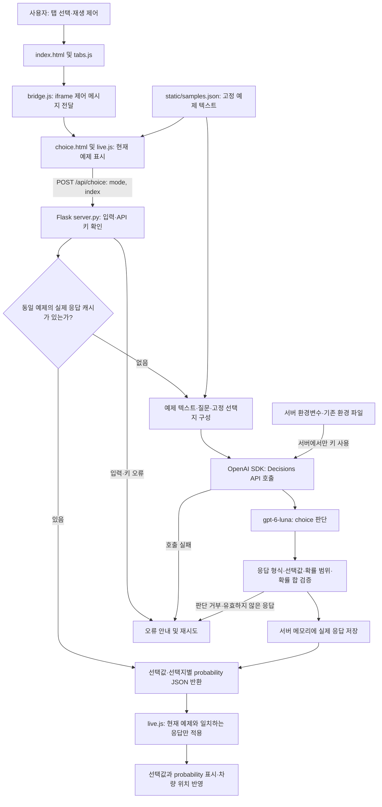

이번에는 정해진 선택지 중에서 선택하는 Choice 타입을 설명하겠다. 이 예제는 `gpt-6-luna` 모델에서 Descisions API의 choice 타입을 사용해서 정해진 선택지 중에서 선택하는 데모이다. [공식 Decisions 가이드의 Select from fixed options](https://developers.openai.com/api/docs/guides/decisions?utm_source=chatgpt.com#select-from-fixed-options)를 내 로컬 PC 또는 Mac 환경에서 실행하는 프로젝트이다.

{: style="width: 70%; height: auto;"}

- Driving: 표시된 장애물 배치에 해당하는 텍스트 설명으로 Lane 1/2/3을 판단한다. 화면의 이미지 자체를 분석하는 기능은 아니다. 차량은 API가 선택한 차선으로 이동한다.
- Team routing: 현재 고객 문의를 Billing / Technical support / Account access 중 하나로 분류한다.
- Document type: 현재 문서의 표시 텍스트를 Invoice / Receipt / Contract 중 하나로 분류한다.

공식 문서의 Driving / Team routing / Document type 사용자 인터페이스에 실제 Decisions API의 `choice` 판단을 연결한다.

---

# 1. 실제 API 연결

실제 Decisions API를 연결하려면 `OPENAI_API_KEY`가 필요하다. 서버 환경 변수인 `.env`의 `OPENAI_API_KEY`를 작성한다.

`POST /api/choice`는 현재 표시되는 고정 예제의 모드와 인덱스만 받는다. 서버가 해당 증거를 `client.decisions.create(model="gpt-6-luna", questions=[choice 질문])`로 전송하고 선택값과 각 선택지의 probability를 반환한다.

기록된 확률을 재생하지 않는다. 응답 전에는 `—`, 실패·거부 시 오류와 재시도 버튼을 표시한다. 실제 확률은 0~1 범위, 소수점 두 자리로 표시한다. 응답과 현재 항목이 다르면 화면에 적용하지 않는다.

새 항목은 실제 API 사용량과 과금이 발생한다. 자동 재생은 응답 후 5초마다 다음 항목으로 넘어간다. Driving 6개, 나머지 각 3개다. 같은 항목의 실제 응답은 서버 실행 동안 메모리에 보관하고 재사용한다. 서버 재시작 시 캐시는 초기화된다. Pause animation으로 자동 전환을 멈출 수 있다.

---

# 2. 예제 실행

## 2-1. Windows 11 운영체제 (PowerShell)

```powershell
python -m venv .venv
.\.venv\Scripts\Activate.ps1
.\.venv\Scripts\python.exe -m pip install -r requirements.txt
.\.venv\Scripts\python.exe server.py --port 5055
```

http://127.0.0.1:5055/ 에 접속한다. Windows에서는 `run-local.cmd`를 실행해도 된다. 

## 2-2. macOS / Linux 운영체제 (bash·zsh)

Python 3.10 이상이 설치된 환경에서 decisions-fixed-options 프로젝트 폴더로 이동한 뒤 다음 명령을 실행한다. 기존 API 키는 위의 실제 API 연결 설명에 따라 .env에 설정한다.

```powershell
python -m venv .venv
source .venv/bin/activate
./.venv/bin/python -m pip install -r requirements.txt
./.venv/bin/python app.py --port 5055
```

같은 컴퓨터의 브라우저에서 http://127.0.0.1:5055/에 접속한다. 실행 중인 터미널은 열어 둔다. 다른 포트를 사용하려면 ./.venv/bin/python app.py --port 5055으로 실행하고 http://127.0.0.1:5055/에 접속한다. run-local.cmd는 Windows 전용이다.

서버는 Ctrl+C로 종료하고, 가상환경은 deactivate로 비활성화한다.

참고로 Codex의 제한된 실행 환경이나 내부 미리보기에서 연결 시간이 초과되면 일반 Windows Terminal 또는 PowerShell에서 실행하고 일반 브라우저로 접속한다.

## 2-3. 검증

```powershell
.\.venv\Scripts\python.exe -m unittest discover -s tests -v
```

`verify_ui.py`는 Playwright와 Edge가 있을 때 실행하는 별도 UI 검증이다. 브라우저 테스트에서는 모의 API 응답을 사용한다. 실제 API 검증 결과는 `VALIDATION.md`에 구분해서 기록한다.

공식 배포 자료에서 추출한 HTML·CSS·폰트를 사용하며 원본 개발 저장소 전체를 포함하지 않는다. `build-reference.cjs`는 UI를 다시 추출하는 도구이며 실제 응답 표시 로직은 `static/reference/live.js`에 있다.

---

# 3. 아키텍처 플로우



Driving은 현재 장애물 배치를 설명한 텍스트로 차선을 판단하고, Team routing은 고객 문의를 담당 팀으로 분류하며, Document type은 문서 텍스트를 유형별로 분류한다. Driving의 화면 이미지 자체를 API로 분석하지 않는다.

응답 전에는 `—`를 표시하고, 실제 응답의 probability를 0~1 범위·소수점 두 자리로 표시한다. 새 판단에는 API 사용량이 발생하며, 동일 예제는 서버에 저장된 실제 응답을 재사용한다. 캐시는 서버 재시작 시 초기화되고 API 키는 브라우저에 전달하지 않는다. 자동 전환은 응답 후 진행하며 Pause animation으로 멈출 수 있다.

---

# 4. 메인 소스 분석

```python
import argparse
import json
import math
import os
import threading
from pathlib import Path
from dotenv import load_dotenv, dotenv_values
from flask import Flask, jsonify, request, send_file
from openai import OpenAI, OpenAIError

# 현재 파일의 위치를 기준으로 환경 설정 파일을 읽는다.
ROOT = Path(__file__).resolve().parent
for path in (ROOT / '.env.local', ROOT / '.env'):
    load_dotenv(path)
if os.environ.get('OPENAI_ENV_FILE'):
    load_dotenv(os.environ['OPENAI_ENV_FILE'])
    # 빈 키 설정은 기존 환경 파일의 유효한 키를 가로막지 않도록 한다.
    if not os.environ.get('OPENAI_API_KEY', '').strip():
        existing_key = dotenv_values(os.environ['OPENAI_ENV_FILE'], encoding='utf-8-sig').get('OPENAI_API_KEY')
        if existing_key:
            os.environ['OPENAI_API_KEY'] = existing_key

# 현재 환경에 키가 없을 때만 기존 형제 프로젝트의 키 파일을 읽는다.
elif not os.environ.get('OPENAI_API_KEY'):
    load_dotenv(ROOT.parent / 'decisions-complaint-router-BAK' / '.env')

# Decisions API를 호출하고 결과를 캐시하는 서버를 제공한다.
app = Flask(__name__)
SAMPLES = json.loads((ROOT / 'static/samples.json').read_text(encoding='utf-8'))
# Choices와 질문을 정의하고 각 모드에 대해 선택지와 질문을 매핑한다.
CHOICES = {
    'driving': [('Lane 1', 'The left lane'), ('Lane 2', 'The middle lane'), ('Lane 3', 'The right lane')],
    'routing': [('Billing', 'Charges, payments, refunds and invoices'), ('Technical support', 'Product errors and broken functionality'), ('Account access', 'Login and authentication problems')],
    'document': [('Invoice', 'Requests a payment that is due'), ('Receipt', 'Confirms a completed payment'), ('Contract', 'Agreement defining obligations between parties')],
}
QUESTIONS = {
    'driving': 'Which lane should the car choose? Choose an unobstructed lane. Prefer lane 2 if clear; otherwise prefer lane 1 if clear, then lane 3.',
    'routing': 'Which team should handle this customer message?',
    'document': 'What kind of document is this?',
}
CACHE = {}
LOCK = threading.Lock()

def evaluate(mode, index):
    # 현재 예제를 Decisions API로 판단하고 검증한 실제 응답을 메모리에 보관한다.
    # 여러 요청이 같은 예제를 동시에 처리하지 않도록 캐시와 API 호출을 보호한다.
    with LOCK:
        key = (mode, index)
        if key in CACHE:
            return {**CACHE[key], 'cached': True}
        # 요청 시간이 무한정 늘어나지 않도록 제한하고 사용이 끝나면 API 클라이언트를 닫는다.
        with OpenAI(timeout=45, max_retries=0) as client:
            # 화면의 증거와 평가 기준을 실제 Decisions API로 전달한다.
            decision = client.decisions.create(model='gpt-6-luna', input=SAMPLES[mode][index], questions=[{
                'name': mode, 'type': 'choice', 'instructions': QUESTIONS[mode],
                'choices': [{'value': value, 'description': description} for value, description in CHOICES[mode]],
            }])
        # API 응답이 올바른지 검증하고 선택 결과와 확률을 반환한다.
        if not decision.answers or decision.answers[0].type != 'choice':
            raise ValueError('API가 판단을 거부했습니다. 확률을 표시할 수 없습니다.')
        
        answer = decision.answers[0] # API 응답의 선택지와 확률이 정의된 범위 내에 있는지 확인
        values = [value for value, _ in CHOICES[mode]] # 선택지와 확률이 정의된 범위 내에 있는지 확인

        # 선택지와 확률이 정의된 범위 내에 있는지 확인
        probabilities = {item.value: item.probability for item in answer.probabilities} 
        if (set(probabilities) != set(values) or answer.choice not in values
                or any(not math.isfinite(p) or not 0 <= p <= 1 for p in probabilities.values())
                or not math.isclose(sum(probabilities.values()), 1, abs_tol=0.001)):
            raise ValueError('API 확률 응답이 올바르지 않습니다.')
        result = {'choice': answer.choice, 'probabilities': probabilities, 'source':'decisions_api', 'cached':False}
        CACHE[key] = result
        return result

@app.get('/')
def index():
    # 루트 주소에서 프로젝트의 데모 화면을 제공한다.
    return send_file(ROOT / 'index.html')

@app.post('/api/choice')
def choice():
    # 모드와 예제 번호를 검증한 뒤 실제 선택 결과와 확률을 JSON으로 반환한다.
    data = request.get_json(silent=True)
    if not isinstance(data, dict):
        return jsonify(error='예제를 지정하세요.'), 400
    mode, index = data.get('mode'), data.get('index')
    if not isinstance(mode, str) or mode not in SAMPLES or type(index) is not int or not 0 <= index < len(SAMPLES[mode]):
        return jsonify(error='지원하지 않는 예제입니다.'), 400
    # 키가 없으면 외부 요청을 보내지 않고 설정 오류를 반환한다.
    if not os.environ.get('OPENAI_API_KEY'):
        return jsonify(error='서버에 기존 OPENAI_API_KEY를 설정하고 다시 실행하세요.'), 503
    try:
        return jsonify(evaluate(mode, index))
    # API 연결 실패는 비밀정보를 제외한 오류 응답으로 변환한다.
    except OpenAIError:
        return jsonify(error='Decisions API 호출 실패: 키 권한, 사용 한도 및 네트워크를 확인하세요.'), 502
    except ValueError as error:
        return jsonify(error=str(error)), 502

def main():
    # 실행 인자를 읽고 프로젝트의 주요 작업을 시작한다.
    parser = argparse.ArgumentParser()
    parser.add_argument('--port', type=int, default=5054)
    
    args = parser.parse_args()
    if not 1 <= args.port <= 65535:
        parser.error('Port must be between 1 and 65535')
    # 서버를 시작하고 지정된 포트에서 요청을 수신한다.
    app.run(host='127.0.0.1', port=args.port, threaded=True)

# 파일을 직접 실행한 경우에만 서버나 콘솔 작업을 시작한다.
if __name__ == '__main__':
    main()
```

# 5. 참고 자료

* [OpenAI Developers 문서](https://developers.openai.com/api/docs/guides/decisions?utm_source=chatgpt.com#select-from-fixed-options)
* [decisions-fixed-options 프로젝트 예제 소스](https://github.com/synabreu/openai-decisions-workshop/tree/main/decisions-fixed-options)

