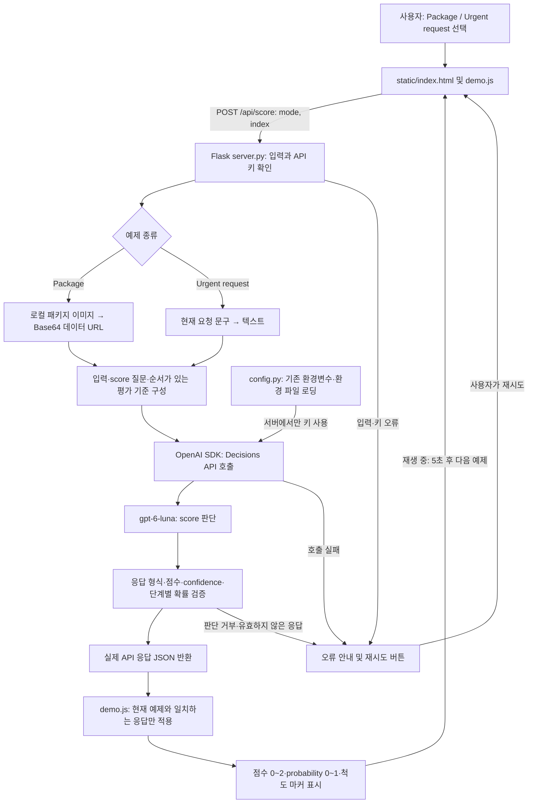

세번째 블로그 내용은 Decisions API의 Score 타입을 이용해 평가 기준에 따라 점수 매기는 예제를 여러분들께 설명하겠다. 이 예제는 gpt-6-luna 모델에서 Descisions 의 Score API를 사용해서 정해진 선택지 중에서 선택하는 데모이다. 공식 [Decisions 가이드의 Score against a rubic](https://developers.openai.com/api/docs/guides/decisions?utm_source=chatgpt.com#score-against-a-rubric)는 내 로컬 PC 또는 Mac 환경에서 직접 실행할 수 있다.

{: style="width: 70%; height: auto;"}

- Package / Urgent request 탭과 키보드 방향키·Home·End 전환
- 패키지 사진과 요청 문구를 순환하며 실제 Decisions API의 score를 표시
- 점수(01), 척도 마커.
- Pause animation / Resume animation.
- 응답 전에는 `—`, 실패 시 오류와 재시도 버튼.

기존 키를 config.py에서 읽으며 브라우저에 전달하지 않는다. 항목이 표시될 때마다 실제 Decisions API를 호출하며 과금이 발생한다. 이전 응답은 재사용하지 않는다. 같은 항목의 요청이 이미 진행 중일 때만 중복 요청을 합친다. 자동 전환은 응답 후 5초마다 실행하며 Pause animation으로 중지할 수 있다.

# 1. 실제 API 연결

실제 Decisions API를 연결하려면 `OPENAI_API_KEY`가 필요하다. 기존 키를 환경변수 또는 `.env`의 `OPENAI_API_KEY`에 설정한다. `config.py`가 키를 서버에서 읽으며 브라우저에는 전달하지 않는다.

# 2. 동작 방식

1) 브라우저의 `static/demo.js`가 현재 탭과 예제 번호를 `POST /api/score`로 전송한다. 페이지를 처음 열거나 탭·예제가 바뀔 때 판단을 요청한다.
2) `server.py`가 예제 종류와 번호 및 API 키를 확인한다. Package는 선택한 패키지 이미지를 Base64 데이터 URL로 구성하고, Urgent request는 현재 요청 문구를 텍스트로 구성한다.
3) 서버가 `client.decisions.create()`로 `gpt-6-luna` 모델에 입력과 `type: score` 질문, 순서가 있는 평가 기준을 전달한다.
4) API가 반환한 점수, confidence, 단계별 probability를 서버가 검증한다. 응답 형식, 점수·확률 범위, 단계 이름과 확률 합이 올바른 경우에만 JSON으로 반환한다.
5) 브라우저는 현재 표시 중인 예제에 해당하는 응답만 적용한다. 실제 점수와 단계별 확률을 소수점 두 자리로 표시하고, 점수에 맞춰 척도 마커와 확률 막대를 갱신한다.

평가 기준은 다음과 같다. 단계 번호는 낮은 수준부터 `0`, `1`, `2`다.

| 탭             | API 입력           | 질문                         | 평가 기준                                 |
| -------------- | ------------------ | ---------------------------- | ----------------------------------------- |
| Package        | 현재 패키지 이미지 | How damaged is this package? | No damage → Minor damage → Major damage |
| Urgent request | 현재 요청 문구     | How urgent is this request?  | Low → Medium → High                     |

`score`는 단계 번호의 확률 가중 평균이다. 예를 들어 세 단계의 probability가 각각 `0.10`, `0.70`, `0.20`이면 점수는 `0×0.10 + 1×0.70 + 2×0.20 = 1.10`이다. `confidence`는 API가 반환하는 별도 값이며 실제 정확도를 보장하지 않는다.

응답 대기 중에는 `—`를 표시한다. 키 누락, API 호출 실패, 판단 거부 또는 유효하지 않은 응답이 발생하면 오류와 재시도 버튼을 표시하며 샘플 값으로 대체하지 않는다.

정상 응답 후 5초가 지나면 다음 예제로 전환해 새 API 요청을 보낸다. 완료된 결과를 캐시하지 않으므로 같은 예제로 돌아와도 다시 호출하며 사용료가 발생한다. 같은 예제의 요청이 이미 진행 중일 때만 중복 요청을 합친다. Pause animation은 자동 전환을 중지하며 이미 진행 중인 API 요청을 취소하지 않는다.

# 3. 예제 실행

## 3-1. Windows 11 운영체제 (PowerShell)

```powershell
python -m venv .venv
.\.venv\Scripts\Activate.ps1
python.exe -m pip install -r requirements.txt
python.exe server.py --port 5083
```

http://127.0.0.1:5083/ 에 접속한다. `run-local.cmd`로도 실행할 수 있다.

기존 문서 주소 `/api/docs/guides/decisions`와 `/playground`, 이전 데모 HTML 주소는 현재 데모 `/`로 자동 이동한다. 서버 소스 수정 후에는 실행 중인 서버를 종료하고 다시 실행한다.

현재 PC의 `.venv`는 Python 3.12로 구성되어 있다. 이미 설치했다면 위 실행 명령만 사용한다. 기존 `.venv`에 `python -m venv .venv`를 다시 실행하지 않는다. 다른 버전의 Python으로 덮어쓰면 실행 파일 복사 오류와 바이너리 패키지 불일치가 발생할 수 있다.

## 3-2. macOS / Linux 운영체제 (bash·zsh)

Python 3.10 이상이 설치된 환경에서 decisions-fixed-options 프로젝트 폴더로 이동한 뒤 다음 명령을 실행한다. 기존 API 키는 위의 실제 API 연결 설명에 따라 .env에 설정한다.

```powershell
python -m venv .venv
source .venv/bin/activate
./.venv/bin/python -m pip install -r requirements.txt
./.venv/bin/python app.py --port 5055
```

같은 컴퓨터의 브라우저에서 http://127.0.0.1:5083/에 접속한다. 실행 중인 터미널은 열어 둔다. 다른 포트를 사용하려면 ./.venv/bin/python app.py --port 5083으로 실행하고 http://127.0.0.1:5083/에 접속한다. run-local.cmd는 Windows 전용이다.

서버는 Ctrl+C로 종료하고, 가상환경은 deactivate로 비활성화한다.

참고로 Codex의 제한된 실행 환경이나 내부 미리보기에서 연결 시간이 초과되면 일반 Windows Terminal 또는 PowerShell에서 실행하고 일반 브라우저로 접속한다.

## 3-3. 검증 테스트

```powershell
.\.venv\Scripts\python.exe -m unittest discover -s tests -v
```

`verify_ui.py`는 Playwright와 Edge를 이용한 모의 응답 UI 검증이다. 실제 API 사용량은 발생시키지 않는다.

# 4. 아키텍처 플로우



브라우저는 요청 중 `—`를 표시하고 API가 반환한 실제 점수와 확률만 표시한다. 완료된 응답을 캐시하지 않으므로 예제가 표시될 때마다 API를 다시 호출하며 사용료가 발생한다. 같은 예제의 요청이 진행 중일 때만 중복 요청을 합친다. Pause animation은 다음 예제로의 자동 전환을 멈추며, API 키는 서버에서만 사용한다.

# 5. 전체 폴더별 파일 구성

[GitHub의 decisions-score-rubric](https://github.com/synabreu/openai-decisions-workshop/tree/main/decisions-score-rubric)에 등록된 전체 파일 31개를 기준으로 정리한다. 로컬에만 있는 환경 파일, 가상환경, 캐시, 검증 결과, setup.ps1 및 runtime_check.py 등은 포함하지 않는다.

| 폴더                  | 파일명                              | 내용 및 역할                                                                                              |
| --------------------- | ----------------------------------- | --------------------------------------------------------------------------------------------------------- |
| 프로젝트 루트         | `.env.example`                    | API 키와 기존 환경 파일 경로를 설정하는 빈 예제 양식이다. 실제 비밀값은 포함하지 않는다.                  |
| 프로젝트 루트         | `.gitignore`                      | 환경 파일, 가상환경, 캐시 및 실행 결과의 Git 업로드를 제외한다.                                           |
| 프로젝트 루트         | `README.md`                       | 실행 방법, 실제 API 동작 및 프로젝트 구성을 안내한다.                                                     |
| 프로젝트 루트         | `config.py`                       | 환경변수와 프로젝트 환경 파일 또는 OPENAI_ENV_FILE에 지정한 기존 파일에서 API 키를 읽는다.                |
| 프로젝트 루트         | `requirements.txt`                | Flask, OpenAI SDK, python-dotenv 등 실행 의존성을 정의한다.                                               |
| 프로젝트 루트         | `run-local.cmd`                   | Windows에서 프로젝트 가상환경의 Python으로 서버를 실행한다.                                               |
| 프로젝트 루트         | `score_example.py`                | 고정된 Safari/Chrome 문제 설명을 severity 기준으로 실제 API에 전달하고 점수 또는 판단 거부를 출력한다.    |
| 프로젝트 루트         | `server.py`                       | 데모 화면과 /api/score를 제공하고 예제 입력 구성, 실제 API 호출, 점수·확률 검증 및 오류 처리를 수행한다. |
| `static/`           | `demo.css`                        | 데모 카드의 배치와 반응형 스타일, 재생 버튼 및 오류 안내를 정의한다.                                      |
| `static/`           | `demo.js`                         | 탭과 예제를 제어하고 실제 API 요청, 응답 대기·점수 표시, 자동 재생 및 재시도를 처리한다.                 |
| `static/`           | `index.html`                      | Package / Urgent request 탭, 이미지·문구, 점수·확률 및 재생·재시도 컨트롤을 배치한다.                  |
| `static/reference/` | `OpenAISans-Bold.woff`            | OpenAI Sans의 굵은 글꼴을 WOFF 형식으로 제공한다.                                                         |
| `static/reference/` | `OpenAISans-Bold.woff2`           | OpenAI Sans의 굵은 글꼴을 WOFF2 형식으로 제공한다.                                                        |
| `static/reference/` | `OpenAISans-BoldItalic.woff2`     | OpenAI Sans의 굵은 기울임 글꼴을 WOFF2 형식으로 제공한다.                                                 |
| `static/reference/` | `OpenAISans-Light.woff`           | OpenAI Sans의 가는 글꼴을 WOFF 형식으로 제공한다.                                                         |
| `static/reference/` | `OpenAISans-Medium.woff`          | OpenAI Sans의 중간 굵기 글꼴을 WOFF 형식으로 제공한다.                                                    |
| `static/reference/` | `OpenAISans-Medium.woff2`         | OpenAI Sans의 중간 굵기 글꼴을 WOFF2 형식으로 제공한다.                                                   |
| `static/reference/` | `OpenAISans-MediumItalic.woff2`   | OpenAI Sans의 중간 굵기 기울임 글꼴을 WOFF2 형식으로 제공한다.                                            |
| `static/reference/` | `OpenAISans-Regular.woff`         | OpenAI Sans의 기본 글꼴을 WOFF 형식으로 제공한다.                                                         |
| `static/reference/` | `OpenAISans-Regular.woff2`        | OpenAI Sans의 기본 글꼴을 WOFF2 형식으로 제공한다.                                                        |
| `static/reference/` | `OpenAISans-RegularItalic.woff2`  | OpenAI Sans의 기본 기울임 글꼴을 WOFF2 형식으로 제공한다.                                                 |
| `static/reference/` | `OpenAISans-Semibold.woff`        | OpenAI Sans의 약간 굵은 글꼴을 WOFF 형식으로 제공한다.                                                    |
| `static/reference/` | `OpenAISans-Semibold.woff2`       | OpenAI Sans의 약간 굵은 글꼴을 WOFF2 형식으로 제공한다.                                                   |
| `static/reference/` | `OpenAISans-SemiboldItalic.woff2` | OpenAI Sans의 약간 굵은 기울임 글꼴을 WOFF2 형식으로 제공한다.                                            |
| `static/reference/` | `SOURCE.md`                       | 공식 배포 화면 자료의 출처와 추출·수정 정보를 기록한다.                                                  |
| `static/reference/` | `demo.css`                        | 공식 데모의 이미지·요청 문구·점수·척도·확률 막대 스타일과 로컬 글꼴을 정의한다.                       |
| `static/reference/` | `package-intact.webp`             | 손상되지 않은 패키지 이미지로 화면 표시와 실제 API 입력에 사용한다.                                       |
| `static/reference/` | `package-major.webp`              | 크게 손상된 패키지 이미지로 화면 표시와 실제 API 입력에 사용한다.                                         |
| `static/reference/` | `package-minor.webp`              | 경미하게 손상된 패키지 이미지로 화면 표시와 실제 API 입력에 사용한다.                                     |
| `tests/`            | `test_server.py`                  | 모의 API 응답으로 입력 검증, 요청 구성, 점수·확률 처리 및 화면 경로를 검증한다.                          |
| 프로젝트 루트         | `verify_ui.py`                    | Playwright와 Edge에서 모의 API 응답을 사용해 탭, 점수 표시, 재생 제어와 모바일 화면을 검증한다.           |

# 6. 메인 소스 분석

## 6-1. server.py

```python
import base64
import math
import os
from flask import Flask, jsonify, request, send_from_directory, redirect, url_for
from openai import OpenAI, APIStatusError, OpenAIError
from config import ROOT
from runtime_check import ensure_compatible_python

# 현재 Python 버전이 최소 요구 사항을 충족하는지 확인
ensure_compatible_python()

# 현재 환경에 키가 없을 때만 기존 형제 프로젝트의 키 파일을 읽는다.
app = Flask(__name__)
app.config['MAX_CONTENT_LENGTH'] = 32 * 1024
# Choices와 질문을 정의하고 각 모드에 대해 선택지와 질문을 매핑한다.
TEXTS = [
    'Could you add a dark mode? It would be helpful when I work at night.',
    'CSV exports keep failing for one teammate. The rest of our team can still export.',
    'Checkout is failing for every customer. We haven’t processed an order in 20 minutes.',
]
RUBRICS = {
    'package': ('How damaged is this package?', [
        {'label': 'No damage', 'description': 'The package has no visible damage.'},
        {'label': 'Minor damage', 'description': 'Minor dents or wear; the package remains intact.'},
        {'label': 'Major damage', 'description': 'Major crushing, tearing, or structural damage.'}]),
    'urgency': ('How urgent is this request?', [
        {'label': 'Low', 'description': 'A feature request or nonblocking issue.'},
        {'label': 'Medium', 'description': 'A task fails for some users, but others can still work.'},
        {'label': 'High', 'description': 'A critical task is blocked for every customer.'}]),
}

def evidence(mode, index):
    # 선택한 요청 문구 또는 패키지 이미지를 API 입력 형식으로 구성한다.
    if mode == 'urgency':
        return TEXTS[index]
    name = ['package-intact.webp', 'package-minor.webp', 'package-major.webp'][index]
    data = base64.b64encode((ROOT / 'static/reference' / name).read_bytes()).decode()
    return [{'role': 'user', 'content': [{'type': 'input_image', 'image_url': 'data:image/webp;base64,' + data}]}]

@app.get('/')
def index():
    # 루트 주소에서 프로젝트의 데모 화면을 제공한다.
    return send_from_directory(ROOT / 'static', 'index.html')


@app.get('/api/docs/guides/decisions')
@app.get('/api/docs/guides/decisions/')
@app.get('/playground')
@app.get('/playground/')
@app.get('/static/official/index.html')
@app.get('/static/original.html')
@app.get('/static/reference/original.html')
@app.get('/static/reference/live.html')
def legacy_demo():
    # 기존 문서와 분석 주소를 현재 데모의 루트 주소로 연결한다.
    return redirect(url_for('index'), code=302)

@app.post('/api/score')
def score():
    # 예제 입력을 채점하고 점수와 단계별 확률을 검증해 반환한다.
    data = request.get_json(silent=True)
    if not isinstance(data, dict):
        return jsonify(error='올바른 JSON 입력이 필요합니다.'), 400
    mode, index = data.get('mode'), data.get('index')
    if not isinstance(mode, str) or mode not in RUBRICS or type(index) is not int or not 0 <= index < 3:
        return jsonify(error='예제 종류와 번호를 확인하세요.'), 400
    # 키가 없으면 외부 요청을 보내지 않고 설정 오류를 반환한다.
    if not os.environ.get('OPENAI_API_KEY', '').strip():
        return jsonify(error='기존 OPENAI_API_KEY를 찾을 수 없습니다. README의 설정을 확인하세요.'), 503
    instructions, levels = RUBRICS[mode]
    try:
        # 요청 시간이 무한정 늘어나지 않도록 제한하고 사용이 끝나면 API 클라이언트를 닫는다.
        with OpenAI(timeout=45, max_retries=0) as client:
            # 선택한 입력과 질문을 실제 Decisions API로 전달한다.
            result = client.decisions.create(model='gpt-6-luna', input=evidence(mode, index), questions=[
                {'type': 'score', 'name': mode, 'instructions': instructions, 'levels': levels}])
        answers = result.model_dump(mode='json')['answers']
        if len(answers) != 1 or answers[0].get('type') != 'score':
            return jsonify(error='판단이 거부되었거나 채점 응답이 없습니다.'), 422
        answer = answers[0]
        value, confidence = answer['score'], answer['confidence']
        probs = answer['probabilities']
        # 유한하지 않은 값과 허용 범위를 벗어난 수치는 정상 결과로 표시하지 않는다.
        if not math.isfinite(value) or not 0 <= value <= 2 or not math.isfinite(confidence) or not 0 <= confidence <= 1:
            raise ValueError()
        if len(probs) != 3 or {p['label'] for p in probs} != {l['label'] for l in levels}:
            raise ValueError()
        if any(not math.isfinite(p['probability']) or not 0 <= p['probability'] <= 1 for p in probs):
            raise ValueError()
        if abs(sum(p['probability'] for p in probs) - 1) > .02:
            raise ValueError()
        return jsonify(source='decisions_api', answer=answer)
    # API 상태 코드를 기준으로 접근 권한과 요청 오류를 안내한다.
    except APIStatusError as exc:
        return jsonify(error=f'API HTTP {exc.status_code}: 키 권한, 사용 한도 및 요청을 확인하세요.'), 502
    # API 연결 실패는 비밀정보를 제외한 오류 응답으로 변환한다.
    except OpenAIError:
        return jsonify(error='API 연결에 실패했습니다. 네트워크와 서비스 상태를 확인하세요.'), 502
    except (ValueError, KeyError, TypeError):
        return jsonify(error='채점 응답 형식이 올바르지 않습니다.'), 502

# 파일을 직접 실행한 경우에만 서버나 콘솔 작업을 시작한다.
if __name__ == '__main__':
    app.run(host='127.0.0.1', port=int(os.environ.get('PORT', '5083')), debug=False)
```

## 6-2. Score_example.py

```python
import config  # 사용이 승인된 기존 키를 복사하지 않고 읽는다.
from openai import OpenAI

def main():
    # 고정된 문제 설명을 실제 API로 채점하고 점수 또는 판단 거부를 출력한다.
    # 요청 시간이 무한정 늘어나지 않도록 제한하고 사용이 끝나면 API 클라이언트를 닫는다.
    with OpenAI(timeout=45, max_retries=0) as client:
        # 화면의 증거와 평가 기준을 실제 Decisions API로 전달한다.
        decision = client.decisions.create(
            model="gpt-6-luna",
            input="Export fails in Safari but works in Chrome.",
            questions=[{
                "type": "score",
                "name": "severity",
                "instructions": "How severe is this issue?",
                "levels": [
                    {"label": "Cosmetic", "description": "Appearance only; no lost functionality."},
                    {"label": "Workaround available", "description": "A task fails, but another way works."},
                    {"label": "Fully blocked", "description": "A task fails with no workaround."},
                ],
            }],
        )
    # 반환된 첫 판단의 형식과 점수를 확인할 준비를 한다.
    answer = decision.answers[0] 
    # API 응답의 선택지와 확률이 정의된 범위 내에 있는지 확인
    if answer.type == "refusal":
        print(f"Refused: {answer.name}")
    elif answer.type == "score":
        print(f"Severity: {answer.score} (confidence: {answer.confidence})")

# 파일을 직접 실행한 경우에만 서버나 콘솔 작업을 시작한다.
if __name__ == '__main__':
    main()
```

# 7. 참고 자료

* [OpenAI Developers 문서](https://developers.openai.com/api/docs/guides/decisions?utm_source=chatgpt.com#score-against-a-rubric)
* [decisions-score-rubric 프로젝트 예제 소스](https://github.com/synabreu/openai-decisions-workshop/tree/main/decisions-score-rubric)
